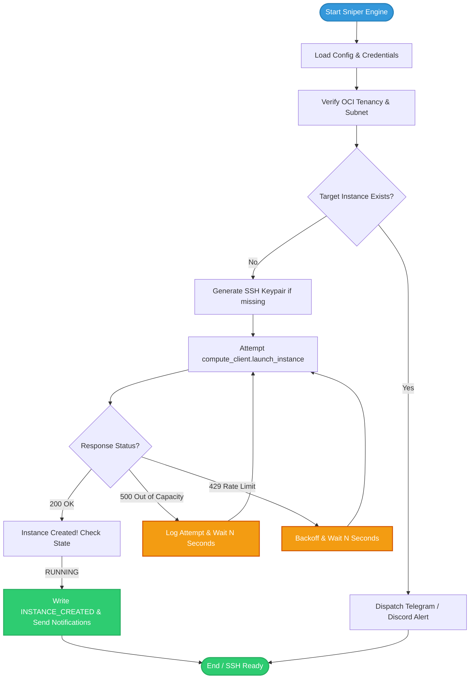

# Oracle Cloud Always-Free Instance Automator

[](https://www.python.org/)
[](https://opensource.org/licenses/MIT)
[](https://cloud.oracle.com)
[](https://telegram.org)

Automate the acquisition of **Oracle Cloud Always-Free ARM Ampere instances** (up to **4 OCPU, 24 GB RAM**) and **AMD Micro instances** (1 OCPU, 1 GB RAM).

Due to immense global demand, acquiring Oracle's Always-Free ARM resources often fails through the web console with `Out of host capacity` or `Out of capacity for shape VM.Standard.A1.Flex`. This project provides a robust, rate-limit-conscious automation engine that snipes capacity the exact moment it frees up.

---

## 🌟 Key Features

- **⚡ Automated Capacity Sniping:** Continuously retries instance creation at configurable intervals until Oracle allocates your resources.
- **☁️ 24/7 Cloud Runner:** Helper scripts to automatically provision a free x86 Micro instance (`VM.Standard.E2.1.Micro`) that runs the sniper 24/7 in the cloud—no need to keep your personal computer awake.
- **🛡️ Production-Grade Security Hardening:** One-click script to enforce UFW (deny-all firewall), Fail2ban brute-force defense, key-only SSH, disabled root login, and automated security upgrades.
- **📲 Instant Multi-Channel Alerts:** Immediate notifications via **Telegram**, **Discord**, and **Gmail** the second your instance is provisioned.
- **⏰ 2-Hour Progress Digests:** Automated cron job posts periodic status reports to Telegram with total attempt counts, server load, and error tracking.
- **💰 100% Always-Free Compliant:** Built-in auditing script (`scripts/audit_costs.py`) verifies your tenancy strictly stays within the \$0.00 free tier limits.

---

## 📐 Architecture & Workflow



---

## 🎁 Oracle Free Tier Resource Limits

Oracle provides an exceptionally generous Always-Free tier:

| Resource | Always-Free Allowance | What This Project Uses |
|---|---|---|
| **ARM Ampere A1 Compute** | **4 OCPU, 24 GB RAM** (up to 4 VMs) | Snipes target ARM instance (e.g. 2 OCPU / 12GB or 4 OCPU / 24GB) |
| **x86 Micro Compute** | **2 VMs** (`VM.Standard.E2.1.Micro`, 1 OCPU / 1GB) | 1 VM used as the 24/7 background sniper runner |
| **Boot & Block Volumes** | **200 GB total storage** | 50 GB per instance (leaving plenty of free space) |
| **Public IPv4** | 1 Ephemeral IPv4 per active instance | Automatically assigned to both runner and target |
| **Outbound Data Transfer** | 10 TB / month | Negligible API traffic |

---

## 🚀 Quickstart Guide

### 1. Prerequisites

1. An active [Oracle Cloud account](https://signup.cloud.oracle.com/).
2. An OCI API Key:
   - In OCI Console: **Profile** (top right) → **API Keys** → **Add API Key**.
   - Download the **Private Key (`.pem`)** and copy the configuration snippet displayed.

### 2. Installation & Configuration

Clone the repository and install dependencies:

```bash
git clone https://github.com/<your-username>/oracle-freetier-automation.git
cd oracle-freetier-automation
```

#### a) Set up `oci_config`
Copy the example config and paste your OCI credentials:
```bash
cp oci_config.example oci_config
chmod 600 oci_config
```
Edit `oci_config`:
```ini
[DEFAULT]
user=ocid1.user.oc1..aaaaaaaaxxxxxxxxxxxxxxxxx
fingerprint=xx:xx:xx:xx:xx:xx:xx:xx:xx:xx:xx:xx
tenancy=ocid1.tenancy.oc1..aaaaaaaaxxxxxxxxxxxxxxxxx
region=ap-hyderabad-1
key_file=/absolute/path/to/your/oci_api_private_key.pem
```

#### b) Set up `oci.env`
Copy the example environment template:
```bash
cp oci.env.example oci.env
```
Key variables to verify:
- `OCT_FREE_AD`: Availability domain name (e.g., `AD-1` or full name from OCI console).
- `OCI_COMPUTE_SHAPE`: `VM.Standard.A1.Flex` (ARM) or `VM.Standard.E2.1.Micro`.
- `REQUEST_WAIT_TIME_SECS`: Recommended `75` to `90` seconds to avoid tenant rate limits.
- `TELEGRAM_TOKEN` & `TELEGRAM_USER_ID`: (Optional) For automated mobile notifications.

---

### 3. Execution Options

#### Option A: Running 24/7 on a Free Cloud VM (Recommended)
Instead of keeping your Mac or PC powered on indefinitely, launch a free Micro VM that runs the sniper inside Oracle's datacenter:

1. **Launch the Free Micro Runner:**
   ```bash
   python3 scripts/create_micro.py
   ```
2. **Deploy the Sniper on the Runner:**
   ```bash
   ssh ubuntu@<RUNNER_PUBLIC_IP> -i id_rsa_private
   git clone https://github.com/<your-username>/oracle-freetier-automation.git
   cd oracle-freetier-automation
   screen -dmS oracle bash setup_init.sh
   ```
3. **Attach / Detach Session:**
   ```bash
   screen -r oracle   # View live output
   # Press Ctrl+A then D to detach safely
   ```

#### Option B: Running Locally
```bash
# Automated setup (creates venv and installs dependencies)
./setup_init.sh

# Re-run after stopping
./setup_init.sh rerun
```

---

## 🔒 Security Hardening (Cloud Runner)

To protect your 24/7 cloud runner from unauthorized access, brute-force bots, or cryptocurrency miners, apply our hardening baseline on the VM:

```bash
# SSH into the runner VM
ssh ubuntu@<RUNNER_IP> -i path/to/id_rsa_private

# Run hardening
sudo ufw default deny incoming
sudo ufw default allow outgoing
sudo ufw allow 22/tcp comment 'SSH'
sudo ufw --force enable

sudo apt-get install -y fail2ban unattended-upgrades
sudo systemctl enable --now fail2ban
```

---

## ⏰ Automated 2-Hour Telegram Reports

Keep track of your sniper without manually checking logs:

```bash
# Test status report manually
python3 scripts/send_status_update.py

# Add to crontab on the runner VM (runs every 2 hours)
(crontab -l 2>/dev/null; echo "0 */2 * * * /usr/bin/python3 $HOME/oracle-freetier-automation/scripts/send_status_update.py >> $HOME/status_cron.log 2>&1") | crontab -
```

Sample Telegram Notification:
```text
📊 OCI Instance Creation — 2-Hour Status Report

• Process Status: 🟢 Running (Active)
• Total Attempts: 78
• Last Attempt Time: 2026-11-21 06:47:38
• Last Result: {'status': 500, 'code': 'InternalError', 'message': 'Out of host capacity.'}
• Load Average: 0.01, 0.03
• Loop Interval: Retrying every 90 seconds
```

---

## 💰 Cost Audit Verification

To confirm that your resources incur strictly **$0.00**, run the included audit utility:

```bash
python3 scripts/audit_costs.py
```

Expected output:
```text
=== 1. COMPUTE INSTANCES AUDIT ===
  Name: micro-ubuntu-runner | Shape: VM.Standard.E2.1.Micro | State: RUNNING

=== 2. STORAGE AUDIT (Free Tier Limit: 200 GB) ===
  --> Total Storage Used: 50 GB / 200 GB (Always Free)

=== COST ASSESSMENT ===
✅ 100% ALWAYS-FREE COMPLIANT. Zero cost incursions detected.
```

---

## ⚙️ Environment Configuration Reference

| Variable | Type | Default | Description |
|---|---|---|---|
| `OCI_CONFIG` | String | `~/.../oci_config` | Absolute path to OCI credentials file |
| `OCT_FREE_AD` | String | `AD-1` | Target Always-Free Availability Domain(s) |
| `DISPLAY_NAME` | String | `my-arm-ubuntu-instance` | Display name of the new compute instance |
| `OCI_COMPUTE_SHAPE`| String | `VM.Standard.A1.Flex` | Target shape (`VM.Standard.A1.Flex` or `VM.Standard.E2.1.Micro`) |
| `REQUEST_WAIT_TIME_SECS`| Integer | `90` | Seconds to wait between creation attempts |
| `SSH_AUTHORIZED_KEYS_FILE`| String | `id_rsa.pub` | SSH public key to embed in the new instance |
| `ASSIGN_PUBLIC_IP` | Boolean | `true` | Automatically assign a public IPv4 address |
| `BOOT_VOLUME_SIZE` | Integer | `50` | Size of boot disk in GB (min 50, max 200 total) |
| `TELEGRAM_TOKEN` | String | *Optional* | Telegram Bot API Token |
| `TELEGRAM_USER_ID` | String | *Optional* | Telegram numeric User ID |
| `DISCORD_WEBHOOK` | String | *Optional* | Discord Webhook URL for alerts |
| `NOTIFY_EMAIL` | Boolean | `false` | Enable Gmail notifications |

---

## ❓ Frequently Asked Questions

#### 1. Why am I seeing `Out of host capacity` in the logs?
This is completely normal. Oracle Cloud's Always-Free ARM nodes are heavily demanded. Whenever another user terminates an instance or Oracle expands capacity in your availability domain, the script will capture the slot.

#### 2. Why do I see `TooManyRequests`?
OCI rate-limits rapid repeated API calls. Set `REQUEST_WAIT_TIME_SECS` to `75`–`90` seconds and ensure you are not running multiple instances of the script simultaneously under the same tenancy.

#### 3. How do I know when the instance is created?
1. You will receive an instant notification on Telegram/Discord/Email.
2. A file named `INSTANCE_CREATED` will appear in the directory containing full instance details and public IP.
3. You can SSH directly into the instance with `ssh ubuntu@<PUBLIC_IP> -i id_rsa_private`.

---

## 📄 License

This project is licensed under the [MIT License](LICENSE).
